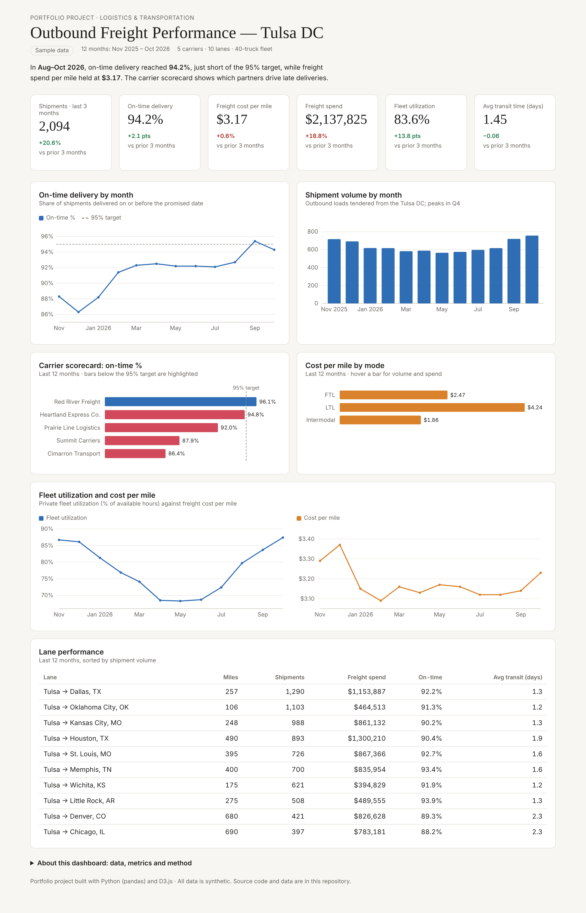

# Outbound Freight Performance Dashboard 🚚

An end-to-end logistics analytics project: synthetic shipment and fleet data → Python & SQL metrics → an interactive D3.js dashboard tracking on-time delivery, freight cost, carrier performance and fleet utilization for a distribution center in Tulsa, OK.

**🔗 Live dashboard:** `https://<your-github-username>.github.io/logistics-freight-dashboard/`



---

## Business question

> Are we delivering on time at a reasonable cost, and which carriers and lanes need attention?

## Key findings (Aug–Oct 2026 vs May–Jul 2026)

| Metric | Value | Change |
|---|---|---|
| Shipments | 2,094 | +20.6% (seasonal Q4 ramp) |
| On-time delivery | 94.2% | +2.1 pts, just short of the 95% target |
| Freight cost per mile | $3.17 | +0.6% |
| Fleet utilization | 83.6% | +13.8 pts |
| Avg transit time | 1.45 days | −0.06 days |

- **Carrier performance varies by almost 10 points.** Red River Freight (96.1%) is the only carrier above target; Cimarron Transport (86.4%) and Summit Carriers (87.9%) drive most late deliveries.
- **Mode mix drives cost.** LTL costs $4.24/mile vs $2.47 for FTL and $1.86 for intermodal, yet LTL is ~47% of shipments.
- **Long-haul lanes are least reliable.** Denver (89.3%) and Chicago (88.2%) have the lowest on-time rates and the longest transit times.
- **Fleet utilization is seasonal.** It drops below 70% in spring and peaks near 87% in Q4, which affects how much freight must go to outside carriers.

## Recommendations

1. Put Cimarron Transport and Summit Carriers on a 90-day performance improvement plan, and shift volume toward Red River and Heartland.
2. Move long-haul Denver and Chicago freight to intermodal where delivery windows allow.
3. Consolidate LTL shipments into FTL on high-volume lanes (Dallas, Kansas City).
4. Use spring fleet slack for backhaul or dedicated runs to lift utilization.

## What's in the dashboard

- KPI cards with change vs the prior 3 months (green = good, red = bad)
- On-time delivery trend against a 95% target
- Monthly shipment volume
- Carrier scorecard with below-target carriers highlighted
- Cost per mile by shipping mode (FTL / LTL / intermodal)
- Fleet utilization and cost-per-mile trends
- Lane performance table
- Hover tooltips on every chart; responsive down to phone width; light and dark mode

## Tech stack

| Layer | Tools |
|---|---|
| Data generation & cleaning | Python, pandas, NumPy |
| Metrics | pandas group-bys, plus equivalent **PostgreSQL** queries in [`freight_metrics.sql`](freight_metrics.sql) |
| Visualization | D3.js v7, HTML, CSS (no build step) |
| Hosting | GitHub Pages |

## Project structure

```
├── index.html            # the dashboard (open in a browser)
├── data.js               # summary tables bundled for the page (built by build_metrics.py)
├── charts.js             # reusable D3 line, bar and horizontal-bar charts with tooltips
├── dash-lite.js          # small data + redraw layer
├── style.css, tokens.css # layout and light/dark theme
├── d3.min.js             # D3 v7.9 (ISC license)
├── generate_data.py      # creates the synthetic raw data (fixed seed, reproducible)
├── build_metrics.py      # cleans and aggregates raw data into summary tables + data.js
├── freight_metrics.sql   # the same metrics in SQL (PostgreSQL)
├── logistics_shipments.csv, logistics_fleet.csv   # raw data: ~7,600 shipment records + 480 truck-month fleet records
├── log_*.csv   # summary tables the dashboard reads
├── requirements.txt
└── dashboard.png         # screenshot
```

## Run it yourself

```bash
pip install -r requirements.txt
python generate_data.py     # rebuild the raw data
python build_metrics.py     # rebuild the summary tables and data.js
```

Then open `index.html` in any browser. No server needed.

## Metric definitions

- **On-time delivery %** = shipments delivered on or before the committed date ÷ all shipments
- **Cost per mile** = total freight cost ÷ total loaded miles (includes LTL accessorials)
- **Fleet utilization** = average share of available truck hours in use (40-truck private fleet)
- **Transit time** = days from pickup to delivery

## About the data

All data is **synthetic**. It was generated with Python to resemble a regional distributor shipping from Tulsa to 10 Midwest/South destinations with 5 carriers and 3 modes, including realistic seasonality, carrier reliability differences and distance effects. Carrier names are fictional. No real company data is used.
